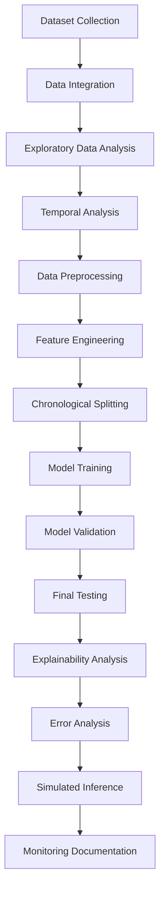
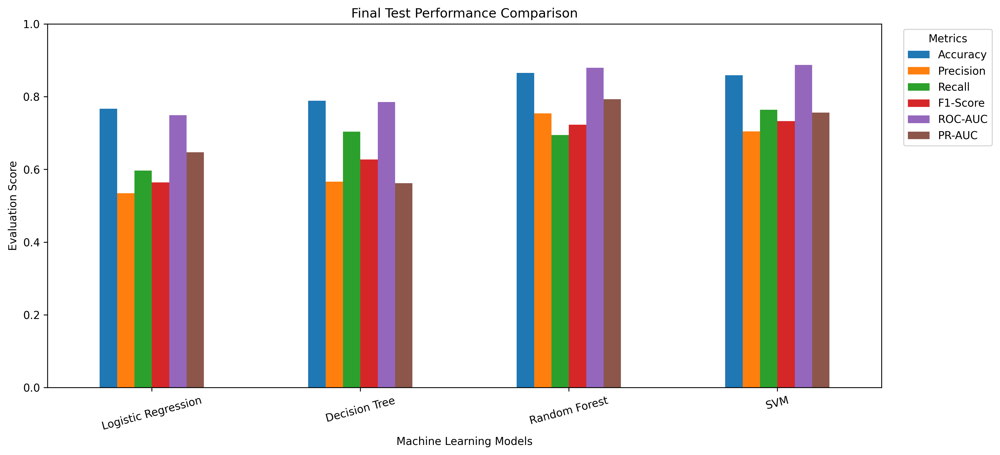
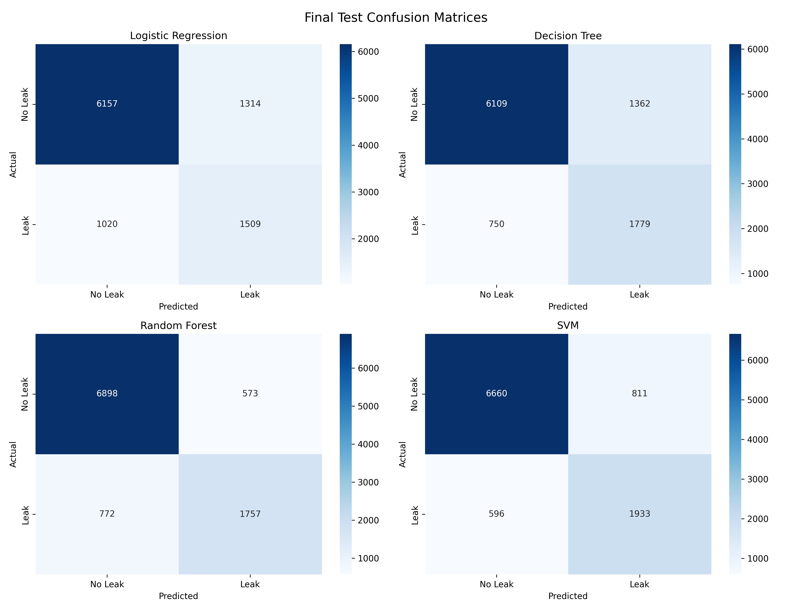
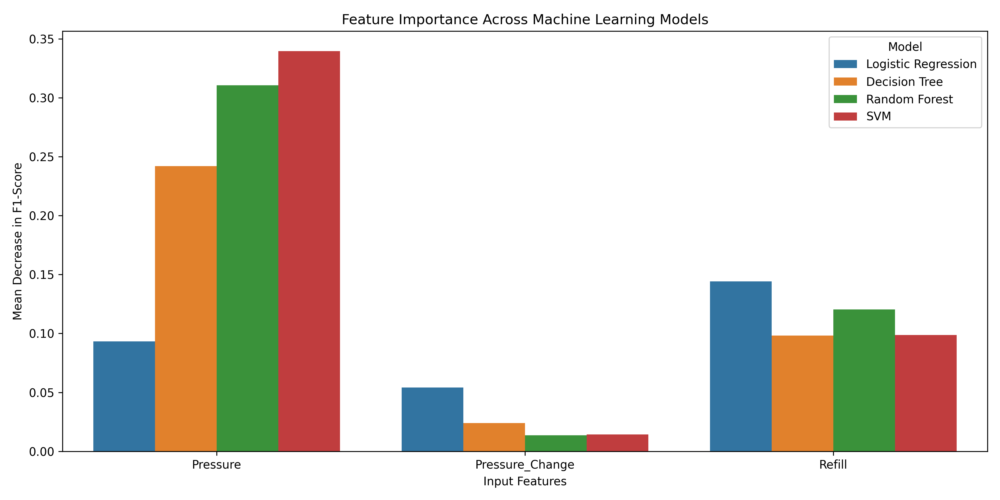
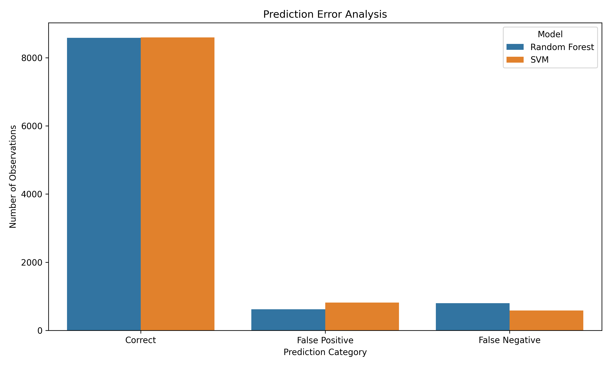

<div align="center">

# 💧 Water Leakage Detection Using Machine Learning

### Intelligent Water Leakage Detection Through Sensor-Based Data Analysis

<p>
  
  
  
  
  
</p>

**A machine learning project for identifying potential water leakage conditions using pressure measurements and refill indicators from a simulated network of connected water tanks.**

</div>

---

## 📌 About the Project

Water leakage is a significant challenge in water storage and distribution systems. Undetected leakage can lead to water wastage, pressure fluctuations and reduced infrastructure efficiency.

This project explores the application of supervised machine learning algorithms to identify potential water leakage conditions using sensor-based measurements.

The system uses a dataset representing **100 connected water tanks** and investigates four classification algorithms to determine their effectiveness in detecting leakage.

The project covers the complete machine learning workflow, from exploratory data analysis and feature engineering to model evaluation, explainability and simulated inference.

### 🎯 Objectives

- Analyse pressure, refill and leakage measurements.
- Identify temporal patterns in leakage behaviour.
- Perform preprocessing and feature engineering.
- Implement and compare four machine learning algorithms.
- Evaluate models using independent testing data.
- Investigate feature importance and prediction errors.
- Develop a simulated prediction system.
- Document deployment architecture and monitoring procedures.

---

## 🛠️ Tech Stack

| Category | Technologies |
|---|---|
| Programming Language | Python |
| Development Environment | Google Colab |
| Data Processing | Pandas, NumPy |
| Visualization | Matplotlib, Seaborn |
| Machine Learning | Scikit-learn |
| Model Persistence | Joblib |
| Version Control | Git, GitHub |

---

## 📊 Dataset

**Source:** [IndustrialNetwork/GraphDataset](https://github.com/IndustrialNetwork/GraphDataset)

The project uses a simulated water tank network dataset containing sensor measurements from 100 connected tanks.

### Dataset Overview

| Attribute | Value |
|---|---:|
| Number of tanks | 100 |
| Number of timestamps | 100,000 |
| Original columns | 301 |
| Measurement CSV files | 12 |
| Total tank-time observations | 10,000,000 |

### Sensor Parameters

| Parameter | Description |
|---|---|
| Pressure | Pressure measurement of each tank |
| Refill | Indicates whether a tank is being refilled |
| Leak | Indicates whether leakage is present |

### Target Variable

| Value | Classification |
|---|---|
| 0 | No Leak |
| 1 | Leak |

The original dataset is simulation-based. It is not a collection of live physical sensor readings.

---

## ⚙️ Project Workflow

The project follows a structured machine learning pipeline.



### 1. Exploratory Data Analysis

The dataset was investigated to understand:

- Pressure distribution.
- Leakage and normal observations.
- Refill behaviour.
- Missing values and data quality.
- Leakage variation across time windows.

### 2. Data Preprocessing

A chronological splitting strategy was used to maintain temporal separation between training, validation and testing observations.

| Dataset | Timestamp Range | Sample Size |
|---|---|---:|
| Training | 0–69,999 | 30,000 |
| Validation | 70,000–84,999 | 10,000 |
| Testing | 85,000–99,999 | 10,000 |
| **Total** | | **50,000** |

Stratified sampling was performed independently within each chronological partition.

### 3. Feature Engineering

Three input features were selected:

| Feature | Description |
|---|---|
| Pressure | Current tank pressure |
| Pressure Change | Difference between current and previous pressure |
| Refill | Binary refill indicator |

Pressure change is calculated using:

\[
\Delta P_t = P_t-P_{t-1}
\]

The first reading uses zero because a previous reading is unavailable.

---

## 🤖 Machine Learning Models

Four supervised classification algorithms were implemented and compared.

| Algorithm | Purpose |
|---|---|
| Logistic Regression | Baseline linear classification |
| Decision Tree | Tree-based decision rules |
| Random Forest | Ensemble classification |
| Support Vector Machine | Nonlinear classification using an RBF kernel |

StandardScaler was used for Logistic Regression and SVM. Tree-based algorithms were trained without scaling.

Class weighting was applied to address the unequal distribution of leakage and normal observations.

---

## 🏆 Model Performance

All four models were evaluated using the held-out test dataset containing 10,000 observations.

### Final Test Results

| Model | Accuracy | Precision | Recall | F1-Score | ROC-AUC |
|---|---:|---:|---:|---:|---:|
| Logistic Regression | 76.66% | 53.45% | 59.67% | 56.39% | 74.90% |
| Decision Tree | 78.88% | 56.64% | 70.34% | 62.75% | 78.53% |
| **Random Forest** | **86.55%** | **75.41%** | 69.47% | 72.32% | 87.98% |
| **SVM** | 85.93% | 70.44% | **76.43%** | **73.32%** | **88.73%** |

### Key Findings

- Random Forest achieved the highest accuracy of **86.55%**.
- Random Forest achieved the highest precision of **75.41%**.
- SVM achieved the highest recall of **76.43%**.
- SVM achieved the highest F1-score of **73.32%**.
- SVM achieved the highest ROC-AUC of **88.73%**.

### Model Selection

**Preferred Model: Support Vector Machine (SVM)**

SVM was selected as the preferred experimental model because it achieved the highest recall and F1-score.

This makes it a suitable candidate when detecting actual leakage observations is a priority.

**Alternative Model: Random Forest**

Random Forest achieved higher accuracy and precision and generated fewer false alarms. It also demonstrated considerably faster batch prediction in our experiment.

The final choice depends on the operational trade-off between missed leaks, false alarms and prediction speed.

### Performance Comparison



### Confusion Matrices



---

## 🔍 Explainability and Error Analysis

Permutation importance was used to investigate the contribution of individual input features.

The analysis was performed using 2,000 validation observations and five permutation repeats.

### Feature Importance

| Feature | Random Forest | SVM |
|---|---:|---:|
| Pressure | 0.31051 | 0.33952 |
| Pressure Change | 0.01360 | 0.01437 |
| Refill | 0.12026 | 0.09880 |

Pressure was the most influential feature for both Random Forest and SVM.



### Prediction Error Analysis

Validation dataset results for the two leading models:

| Error Category | Random Forest | SVM |
|---|---:|---:|
| Correct Predictions | 8,579 | 8,593 |
| False Positives | 621 | 820 |
| False Negatives | 800 | 587 |

SVM produced fewer missed leakage observations, whereas Random Forest generated fewer false alarms.



Permutation importance indicates predictive usefulness and does not establish causal relationships.

---

## 🏗️ Proposed Deployment Architecture

The proposed system follows this workflow:

```text
       WATER TANK SENSORS
               |
               v
        DATA COLLECTION
               |
               v
         DATA VALIDATION
               |
               v
        FEATURE ENGINEERING
               |
               v
         TRAINED SVM MODEL
               |
               v
          LEAK PREDICTION
               |
          +----+----+
          |         |
          v         v
        NORMAL    LEAK ALERT
          |         |
          +----+----+
               |
               v
        MONITORING SYSTEM
               |
               v
         HISTORICAL LOGS
```

A simulated inference function was implemented to demonstrate how incoming pressure and refill readings can be processed by the trained SVM model.

**Deployment status:** Proposed architecture with simulated inference. Physical sensor integration and production deployment have not been implemented.

### Monitoring Strategy

The documented monitoring procedures include:

- Prediction performance monitoring.
- False positive and false negative analysis.
- Sensor data quality checks.
- Pressure and refill distribution monitoring.
- Data drift investigation.
- Inference latency measurement.
- Retraining when verified performance degradation occurs.

---

## 📁 Repository Structure

```text
water-leakage-detection-ml/
│
├── README.md
├── requirements.txt
├── CHANGELOG.md
├── .gitignore
│
├── notebooks/
│   └── Water_Leakage_Detection_Rebuild.ipynb
│
├── models/
│   ├── logistic_regression.joblib
│   ├── decision_tree.joblib
│   ├── random_forest.joblib
│   └── svm.joblib
│
├── outputs/
│   ├── figures/
│   └── metrics/
│
├── documentation/
│   ├── MODEL_CARD.md
│   ├── DATA_DICTIONARY.md
│   ├── ASSUMPTIONS_AND_LIMITATIONS.md
│   ├── dataset_manifest.csv
│   ├── model_configurations.json
│   ├── deployment_architecture.json
│   └── monitoring_procedures.json
│
└── reports/
    ├── FINAL_PROJECT_REPORT.md
    └── FINAL_PROJECT_REPORT.pdf
```

Processed CSV samples are excluded from GitHub pending verification of redistribution permissions.

---

## 🚀 Getting Started

### Requirements

- Python 3.x
- Jupyter Notebook or Google Colab

### Clone the Repository

```bash
git clone https://github.com/prajwalkhatavakar25/water-leakage-detection-ml.git

cd water-leakage-detection-ml
```

### Install Dependencies

```bash
pip install -r requirements.txt
```

### Run the Project

Open the notebook:

`notebooks/Water_Leakage_Detection_Rebuild.ipynb`

Google Colab is recommended for running the complete experimental workflow.

The original dataset must be obtained separately from its source repository and supplied according to the notebook's data-loading requirements.

---

## 📚 Project Documentation

| Document | Description |
|---|---|
| [Final Project Report](reports/FINAL_PROJECT_REPORT.pdf) | Complete technical report |
| [Markdown Report](reports/FINAL_PROJECT_REPORT.md) | Editable report |
| [Model Card](documentation/MODEL_CARD.md) | Model details and evaluation |
| [Data Dictionary](documentation/DATA_DICTIONARY.md) | Dataset feature descriptions |
| [Model Configurations](documentation/model_configurations.json) | Model hyperparameters |
| [Deployment Architecture](documentation/deployment_architecture.json) | Proposed system architecture |
| [Monitoring Procedures](documentation/monitoring_procedures.json) | Monitoring strategy |
| [Assumptions and Limitations](documentation/ASSUMPTIONS_AND_LIMITATIONS.md) | Known limitations |
| [Changelog](CHANGELOG.md) | Project development history |

---

## ⚠️ Assumptions and Limitations

- The dataset represents a simulated water tank network.
- Only three input features are used.
- Model training uses a sampled subset of the original observations.
- Dataset labels are treated as ground truth.
- Inter-tank connectivity is not explicitly included in the current model features.
- Hyperparameter optimization has not been exhaustive.
- Physical sensor integration has not been implemented.
- Real-world model performance has not yet been established.
- Prediction thresholds have not been optimized using operational cost information.

---

## 🔮 Future Improvements

- Incorporate inter-tank connectivity information.
- Investigate additional time-series features.
- Perform systematic hyperparameter optimization.
- Explore probability calibration and threshold selection.
- Validate using real-world sensor measurements.
- Develop a real-time monitoring dashboard.
- Integrate physical sensor hardware.
- Implement automated data drift detection.

---

## 👨‍💻 Project Information

| Attribute | Details |
|---|---|
| Project | Water Leakage Detection Using Machine Learning |
| Developer | [Prajwal Khatavakar](https://github.com/prajwalkhatavakar25) |
| Repository | [water-leakage-detection-ml](https://github.com/prajwalkhatavakar25/water-leakage-detection-ml) |
| Project Type | Academic / Machine Learning Project |
| Version | 1.0.0 |

---

<div align="center">

### 💧 Turning Sensor Data into Actionable Insights

**Built with Python and Machine Learning.**

</div>
