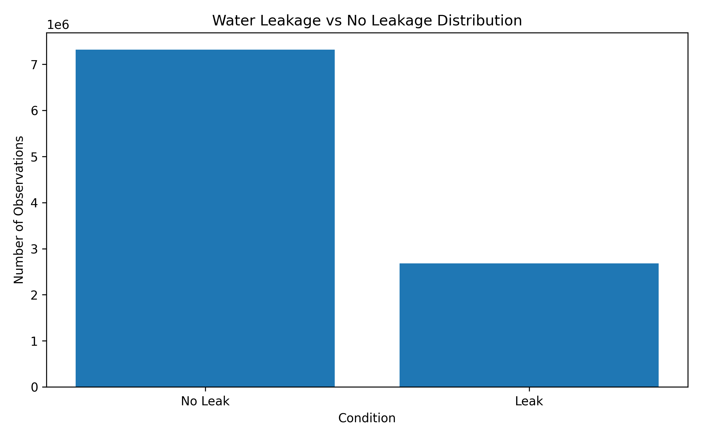
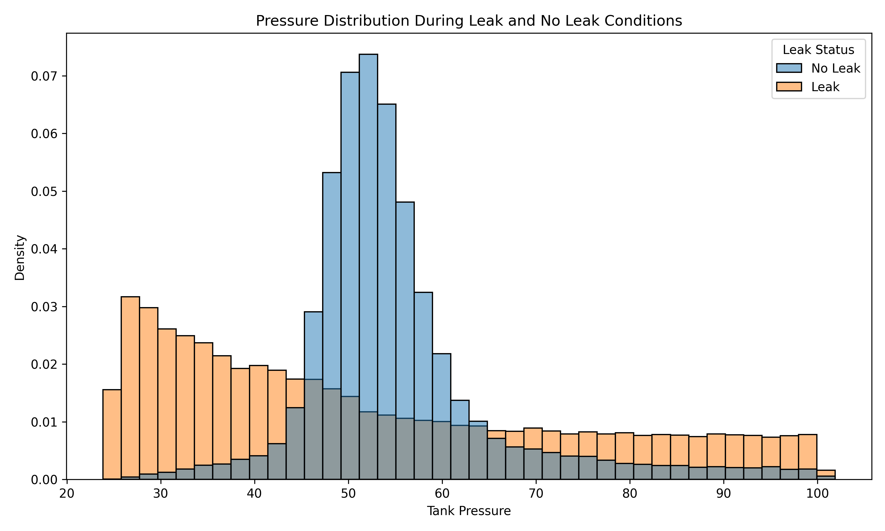
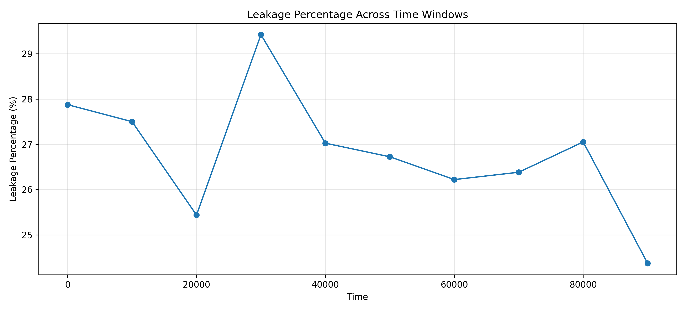
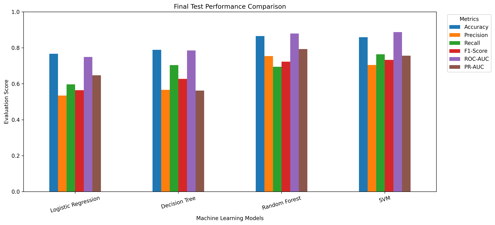
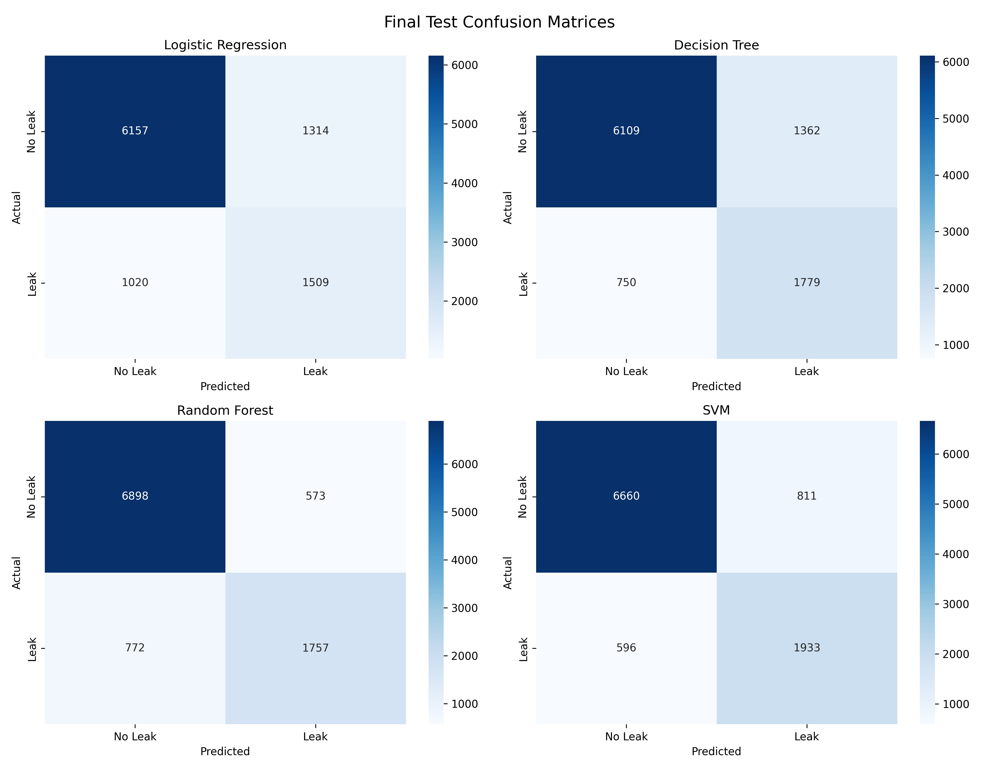
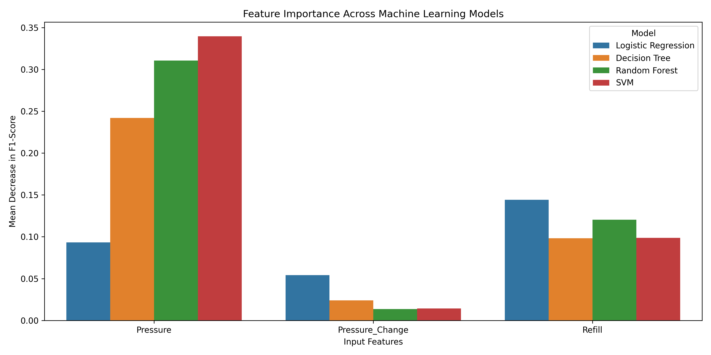
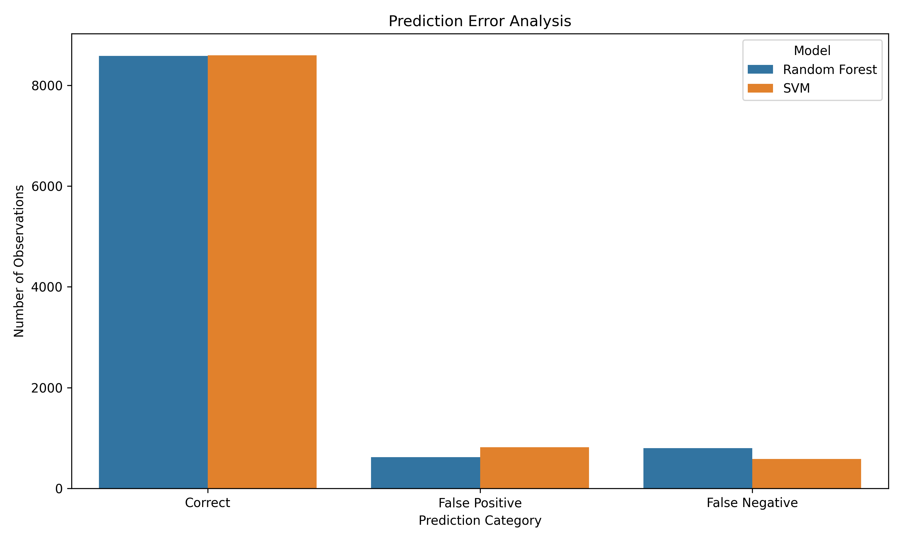

# WATER LEAKAGE DETECTION USING MACHINE LEARNING

## Abstract

This project presents a machine learning-based approach
for detecting water leakage in a network of 100 connected
water tanks.

The dataset contains 100,000 timestamps and 301 columns.
It provides pressure measurements, refill indicators and
binary leakage labels for each tank.

The project implements four classification algorithms:
Logistic Regression, Decision Tree, Random Forest and
Support Vector Machine (SVM).

A chronological training, validation and testing strategy
was adopted. Feature engineering was performed using
pressure, pressure change and refill indicators.

The final testing results showed that Random Forest
achieved the highest accuracy of 86.55%, while SVM
achieved the highest recall of 76.43% and F1-score
of 73.32%.

SVM was selected as the preferred model when detecting
a greater proportion of actual leakage observations
is the primary objective.

A proposed deployment architecture and monitoring
strategy were also documented. A simulated inference
function was implemented to demonstrate predictions
from sensor readings.

## 1. Introduction

Water leakage is an important problem in water storage
and distribution systems. Leakage can result in water
wastage, reduced system efficiency and pressure changes.

Manual inspection can be time-consuming.

Machine learning provides an approach for analysing
sensor readings and identifying patterns associated
with leakage conditions.

This project investigates the use of supervised
classification algorithms for detecting leakage in
a simulated network of connected water tanks.

## 2. Problem Statement

Develop a machine learning system that analyses water
tank pressure and refill measurements to classify
whether a tank is experiencing leakage.

The system should compare multiple classification
algorithms and evaluate their ability to identify
leakage observations.

## 3. Objectives

1. Obtain and understand the water tank dataset.
2. Perform exploratory data analysis.
3. Examine the temporal behaviour of leakage.
4. Prepare features for machine learning.
5. Implement four classification algorithms.
6. Evaluate model performance.
7. Investigate feature importance and prediction errors.
8. Document a proposed deployment architecture.
9. Establish monitoring and reproducibility procedures.

## 4. Literature Review

### 4.1 Khorasgani et al. (2019)

The researchers investigated fault detection and isolation
in industrial networks using Graph Convolutional Neural
Networks.

Their work includes a connected water tank network,
which is the source of the dataset used in this project.

Their research considers relationships between connected
network components. Our implementation instead uses
individual tank measurements as tabular classification
features.

### 4.2 Alves Coelho et al. (2020)

The authors presented a machine learning-based approach
for water leak detection using real-time sensor data.

Their research highlights the use of wireless sensor
networks and automated monitoring for identifying leaks.

### 4.3 Mashhadi et al. (2021)

The researchers investigated machine learning methods
for leak detection and localization in water distribution
systems.

Their study examined pressure and flow-related information
and compared supervised and unsupervised learning methods.

The research demonstrates the importance of selecting
appropriate algorithms for water distribution data.

### 4.4 Kammoun et al. (2022)

This study presents a comparative survey of artificial
intelligence applications for leak detection in water
distribution networks.

It provides an overview of different approaches to
leak detection and localization.

### 4.5 Shen and Cheng (2022)

The authors investigated tree-based machine learning
methods for pipeline leakage detection.

Their research addresses the challenges of identifying
leakage from practical pipeline signals.

### 4.6 Lee and Kim (2023)

The researchers investigated machine learning approaches
for detecting leakage using water pipeline vibration
sensor measurements.

Their work demonstrates the application of machine
learning to sensor-based leak detection.

## 5. Dataset Description

Dataset:
IndustrialNetwork/GraphDataset

Source:
https://github.com/IndustrialNetwork/GraphDataset

Dataset repository commit:

862da8b419e65b240c107a343b72dad44915c811

The repository contains 14 CSV files, including:

- 12 measurement files.
- Tank location information.
- Tank connection matrix.

The 12 measurement files were combined.

Original dataset dimensions:

| Parameter | Value |
|---|---:|
| Rows | 100,000 |
| Columns | 301 |
| Pressure measurements | 100 |
| Refill indicators | 100 |
| Leak indicators | 100 |
| Total tank-time observations | 10,000,000 |

## 6. Exploratory Data Analysis

### 6.1 Data Quality

| Parameter | Result |
|---|---:|
| Missing values | 0 |
| Duplicate rows | 0 |
| Minimum timestamp | 0.0 |
| Maximum timestamp | 99999.0 |
| Time ordering | Strictly increasing |

### 6.2 Sensor Statistics

| Sensor | Minimum | Maximum | Mean |
|---|---:|---:|---:|
| Pressure | 1.2302 | 102.3437 | 54.2629 |
| Refill | 0 | 1 | 0.05998 |
| Leak | 0 | 1 | 0.26801 |

The observed maximum pressure value exceeds 100 slightly.
This observation was retained and not automatically capped.

It should be investigated against the dataset's documented
sensor range before any production use.

### 6.3 Leakage Distribution

| Condition | Observations | Percentage |
|---|---:|---:|
| No Leak | 7,319,875 | 73.20% |
| Leak | 2,680,125 | 26.80% |

### 6.4 Pressure Distribution

### 6.5 Temporal Analysis

Leakage percentages were calculated across ten chronological
windows to investigate changes over time.

| Start Time | End Time | Leak Percentage | Average Pressure | Refill Percentage |
| --- | --- | --- | --- | --- |
| 0.0 | 9999.0 | 27.875 | 54.928 | 6.278 |
| 10000.0 | 19999.0 | 27.5 | 53.934 | 6.127 |
| 20000.0 | 29999.0 | 25.438 | 53.763 | 5.728 |
| 30000.0 | 39999.0 | 29.421 | 53.751 | 6.55 |
| 40000.0 | 49999.0 | 27.025 | 54.13 | 6.06 |
| 50000.0 | 59999.0 | 26.724 | 54.645 | 5.965 |
| 60000.0 | 69999.0 | 26.221 | 54.62 | 5.869 |
| 70000.0 | 79999.0 | 26.383 | 53.672 | 5.894 |
| 80000.0 | 89999.0 | 27.053 | 53.949 | 6.055 |
| 90000.0 | 99999.0 | 24.372 | 55.236 | 5.452 |

## 7. Data Preprocessing

The dataset was divided chronologically.

| Partition | Timestamp Range | Sample Size |
|---|---|---:|
| Training | 0–69,999 | 30,000 |
| Validation | 70,000–84,999 | 10,000 |
| Testing | 85,000–99,999 | 10,000 |

Stratified sampling was applied independently to each
chronological partition.

The final modelling dataset contains 50,000 observations.

This approach avoids placing observations from the same
timestamp into different partitions.

## 8. Feature Engineering

Three input features were used:

| Feature | Description |
|---|---|
| Pressure | Current tank pressure |
| Pressure Change | Difference between current and previous pressure |
| Refill | Binary refill indicator |

Pressure change was calculated as:

Pressure Change = Current Pressure - Previous Pressure

The target variable is Leak:

- 0 = No Leak
- 1 = Leak

Time and Tank_ID were retained for analysis but were
not included as model input features.

## 9. Machine Learning Implementation

Four supervised classification algorithms were implemented.

### 9.1 Logistic Regression

Used as the baseline linear classification algorithm.

### 9.2 Decision Tree

Used to identify nonlinear relationships through
tree-based decision rules.

### 9.3 Random Forest

An ensemble model using 200 decision trees.

### 9.4 Support Vector Machine

An RBF-kernel SVM was implemented to identify
nonlinear classification boundaries.

StandardScaler was included in the Logistic Regression
and SVM pipelines.

Tree-based models were not scaled.

Class weighting was used to account for the
unequal class distribution.

### 9.5 Model Training Time

| Model | Training Time (seconds) |
| --- | --- |
| Logistic Regression | 0.0583 |
| Decision Tree | 0.4034 |
| Random Forest | 19.2164 |
| SVM | 48.9462 |

## 10. Final Model Evaluation

All four trained models were evaluated using the
previously held-out test sample of 10,000 observations.

### 10.1 Evaluation Metrics

Accuracy measures the proportion of correct predictions.

Precision measures how many predicted leaks were
actually leakage observations.

Recall measures how many actual leakage observations
were detected.

F1-score provides a balance between precision and recall.

ROC-AUC measures the ability to distinguish between
the two classes across classification thresholds.

PR-AUC summarizes the precision-recall relationship.

### 10.2 Final Test Results

| Model | Accuracy | Precision | Recall | F1-Score | ROC-AUC | PR-AUC |
| --- | --- | --- | --- | --- | --- | --- |
| Logistic Regression | 0.7666 | 0.5345 | 0.5967 | 0.5639 | 0.749 | 0.6472 |
| Decision Tree | 0.7888 | 0.5664 | 0.7034 | 0.6275 | 0.7853 | 0.5622 |
| Random Forest | 0.8655 | 0.7541 | 0.6947 | 0.7232 | 0.8798 | 0.7928 |
| SVM | 0.8593 | 0.7044 | 0.7643 | 0.7332 | 0.8873 | 0.7565 |

## 11. Confusion Matrix Analysis

The final test confusion matrix counts are:

| Model | TN | FP | FN | TP |
| --- | --- | --- | --- | --- |
| Logistic Regression | 6157 | 1314 | 1020 | 1509 |
| Decision Tree | 6109 | 1362 | 750 | 1779 |
| Random Forest | 6898 | 573 | 772 | 1757 |
| SVM | 6660 | 811 | 596 | 1933 |

TN = True Negative

FP = False Positive

FN = False Negative

TP = True Positive

Random Forest produced fewer false alarms than SVM.

SVM detected more actual leakage observations and
produced fewer missed leaks.

## 12. Comparative Analysis

Random Forest achieved the highest test accuracy
of 86.55%.

It also obtained the highest precision of 75.41%
and PR-AUC of 79.28%.

SVM achieved the highest recall of 76.43%,
F1-score of 73.32% and ROC-AUC of 88.73%.

SVM detected 1,933 actual leaks and missed 596.

Random Forest detected 1,757 actual leaks and
missed 772.

SVM is therefore preferred when reducing missed
leakage observations is the primary objective.

Random Forest remains an alternative when higher
precision, fewer false alarms and faster predictions
are important.

## 13. Model Explainability

Permutation importance was used to examine the
contribution of individual input features.

The analysis used 2,000 validation observations
and five permutation repeats.

| Model | Feature | Importance | Standard Deviation |
| --- | --- | --- | --- |
| Logistic Regression | Pressure | 0.09328 | 0.01015 |
| Logistic Regression | Pressure_Change | 0.0542 | 0.00651 |
| Logistic Regression | Refill | 0.14418 | 0.00484 |
| Decision Tree | Pressure | 0.24193 | 0.00759 |
| Decision Tree | Pressure_Change | 0.02394 | 0.01257 |
| Decision Tree | Refill | 0.0982 | 0.00453 |
| Random Forest | Pressure | 0.31051 | 0.01461 |
| Random Forest | Pressure_Change | 0.0136 | 0.00704 |
| Random Forest | Refill | 0.12026 | 0.00436 |
| SVM | Pressure | 0.33952 | 0.01954 |
| SVM | Pressure_Change | 0.01437 | 0.00475 |
| SVM | Refill | 0.0988 | 0.00556 |

Pressure had the greatest predictive importance
for SVM, Decision Tree and Random Forest.

Refill was the most important feature for
Logistic Regression.

Pressure Change had comparatively low importance
across the four models.

Permutation importance measures predictive contribution
and does not establish causality.

## 14. Error Analysis

Error analysis was performed using the validation
dataset.

| Model | Error Type | Count |
| --- | --- | --- |
| Random Forest | Correct | 8579 |
| Random Forest | False Positive | 621 |
| Random Forest | False Negative | 800 |
| SVM | Correct | 8593 |
| SVM | False Positive | 820 |
| SVM | False Negative | 587 |

The results indicate a trade-off between false alarms
and missed leakage observations.

SVM produced fewer missed leaks than Random Forest,
while Random Forest generated fewer false alarms.

## 15. Proposed Deployment Architecture

The proposed architecture follows this workflow:

Water Tank Sensors

↓

Data Collection

↓

Data Validation

↓

Feature Engineering

↓

Trained SVM Model

↓

Leak Prediction

↓

Alert Generation

↓

Monitoring Dashboard

↓

Historical Data Logging

A simulated inference function was implemented
to demonstrate how pressure and refill observations
could be passed to the trained model.

Physical sensor integration and production deployment
have not been implemented.

## 16. Model Monitoring

The proposed monitoring procedures include:

- Accuracy, precision, recall and F1-score.
- False positive and false negative monitoring.
- Sensor data quality checks.
- Pressure and refill distribution monitoring.
- Data drift investigation.
- Inference latency measurement.
- Verified maintenance inspection records.

Retraining should be considered when verified
performance degradation is observed.

## 17. Assumptions and Limitations

### Assumptions

1. Dataset leakage labels are treated as ground truth.
2. Pressure and refill measurements provide useful
   information for leakage detection.
3. Previous pressure readings are available to calculate
   pressure change.
4. The dataset is suitable for an initial experimental study.

### Limitations

1. Only three input features were used.
2. Training was performed on a sampled subset.
3. The dataset is simulation-based.
4. The physical sensor system has not been deployed.
5. Hyperparameter tuning was not exhaustive.
6. Inter-tank relationships were not explicitly used
   as model features.
7. Real-world performance remains unverified.
8. Prediction thresholds have not been optimized
   using operational cost information.
9. Permutation importance does not establish causal
   relationships.

## 18. Future Scope

Future improvements may include:

- Adding inter-tank connectivity features.
- Investigating additional time-series features.
- Applying systematic hyperparameter optimization.
- Evaluating calibrated prediction probabilities.
- Testing with actual water distribution measurements.
- Developing a real-time monitoring interface.
- Integrating physical water tank sensors.
- Implementing automated drift detection.

## 19. Conclusion

This project investigated supervised machine learning
methods for detecting water leakage in a simulated
network of connected water tanks.

Four classification models were implemented and
evaluated using a chronological sampling strategy.

Random Forest achieved the highest accuracy,
while SVM achieved the highest recall and F1-score.

Considering that missed leakage events are particularly
important in this application, SVM was selected as
the preferred experimental model.

The project also included feature importance analysis,
error analysis, simulated inference, deployment
documentation and monitoring procedures.

The results demonstrate the potential of machine
learning for sensor-based water leakage detection.

However, further validation with real-world sensor
measurements is required before operational deployment.

## 20. References

1. Khorasgani, H., Hasanzadeh, A., Farahat, A. K., & Gupta, C. (2019).
Fault Detection and Isolation in Industrial Networks using
Graph Convolutional Neural Networks.
2019 IEEE International Conference on Prognostics and
Health Management, 1–7.
https://doi.org/10.1109/ICPHM.2019.8819403

2. Alves Coelho, J., Glória, A., & Sebastião, P. (2020).
Precise Water Leak Detection Using Machine Learning
and Real-Time Sensor Data.
IoT, 1(2), 474–493.
https://doi.org/10.3390/iot1020026

3. Mashhadi, N., Shahrour, I., Attoue, N., El Khattabi, J.,
& Aljer, A. (2021).
Use of Machine Learning for Leak Detection and Localization
in Water Distribution Systems.
Smart Cities, 4(4), 1293–1315.
https://doi.org/10.3390/smartcities4040069

4. Kammoun, M., Kammoun, A., & Abid, M. (2022).
Leak Detection Methods in Water Distribution Networks:
A Comparative Survey on Artificial Intelligence Applications.
Journal of Pipeline Systems Engineering and Practice,
13(3).
https://doi.org/10.1061/(ASCE)PS.1949-1204.0000646

5. Shen, Y., & Cheng, W. (2022).
A Tree-Based Machine Learning Method for Pipeline
Leakage Detection.
Water, 14(18), 2833.
https://doi.org/10.3390/w14182833

6. Lee, S., & Kim, B. (2023).
Machine Learning Model for Leak Detection Using Water
Pipeline Vibration Sensor.
Sensors, 23(21), 8935.
https://doi.org/10.3390/s23218935

## 21. Reproducibility Information

Dataset repository commit:
862da8b419e65b240c107a343b72dad44915c811

Python:
3.13.18

Pandas: 2.2.3

NumPy: 2.4.6

Scikit-learn: 1.6.1

Random seed used for sampling: 42

Dataset checksums are maintained in:
documentation/dataset_manifest.csv

Model configurations are maintained in:
documentation/model_configurations.json
